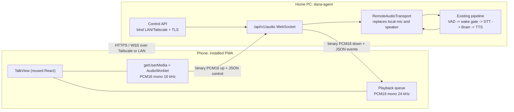
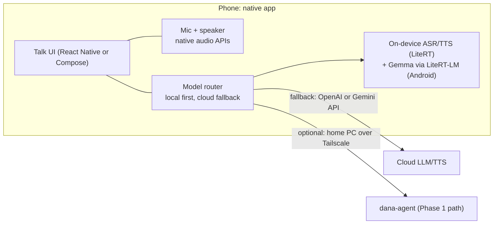
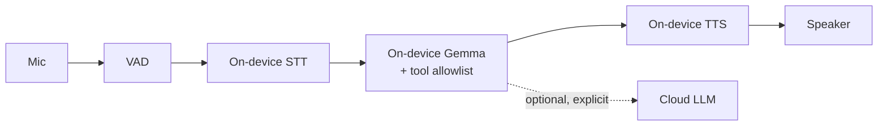

# DaNa Mobile App Plan

Status: proposal for review · Date: 2026-11-05 · Owner: Business Agent
Scope: a phone client that reuses DaNa's conversation mechanism, in three phases.

## Executive summary

- DaNa's mechanism is mic -> VAD -> wake gate -> STT -> brain -> TTS -> speaker. Only the mic and speaker are local to the PC today.
- Phase 1 "Remote client" is the cheapest path to a phone version: an installable PWA that reuses the existing `dana-ui` Talk view and streams audio to the home PC agent.
- Phase 1 needs four agent changes: bind to LAN/Tailscale, serve TLS, pair devices with a QR code, and add a `/api/v1/audio` WebSocket that replaces the local mic/speaker with a remote transport.
- Phase 1 estimate: about 20-25 person-days (estimate). Expected first-audio latency is about 0.8-1.5 s on Tailscale (estimate).
- Phase 2 "Hybrid native" (Expo or Kotlin) adds on-device Gemma via LiteRT-LM on Android. Cloud fallback stays on OpenAI or Gemini. Estimate: 40-60 person-days.
- Phase 3 "Standalone on-device" removes the PC entirely. It is the most privacy-friendly option and the riskiest. Estimate: 80-120 person-days.
- The main constraints are app-store rules on always-on microphones and battery drain. Phase 1 avoids both by using push-to-talk while the app is in the foreground.
- Recommendation: build Phase 1 and pilot it with the owner for 4 weeks before committing to Phase 2.

---

## 1. Current state (what Phase 1 starts from)

| Area | Today | Source |
|---|---|---|
| Control API | FastAPI on `127.0.0.1:8760`, bearer token, REST + `/api/v1/events` WebSocket | `dana-agent/src/dana_agent/control/routes.py` |
| Event auth | Token passed as `?token=` query string (leaks into logs and proxies) | `routes.py` `events()` |
| Talk button | `POST /api/v1/session/activate` trips the wake gate to ACTIVE | `routes.py` |
| Typed turn | `POST /api/v1/session/turn` runs text through the live pipeline | `routes.py` |
| Audio | Capture and playback are on the PC's own mic and speakers. The UI states this explicitly | `dana-ui/src/features/TalkView.tsx` header comment |
| Tokens | One global token in `dana-agent/.dana/control-token`. No per-device tokens | `routes.py` `require_auth` |

Key implication: the pipeline owns the mic. A phone cannot "just open the Talk tab". The agent needs a remote audio transport that feeds the same VAD/wake/STT chain and returns TTS audio over the network.

---

## 2. Phase 1 - Remote client (installable PWA)

### 2.1 Architecture



### 2.2 What is reused

| Component | Reuse | Change needed |
|---|---|---|
| `TalkView.tsx`, `Transcript`, state chip, typed-turn box | As is | Add a transport prop so it talks to `/api/v1/audio` instead of local mic |
| `api/client.ts` and types | Mostly as is | Add audio socket client and device pairing call |
| `Controller`, `EventBus`, brain, gate, audit | As is | None |
| Wake gate FSM | As is | Remote push-to-talk maps to the existing `session/activate` path |
| Control API routes | Extended | Bind address, TLS, pairing, audio endpoint |

### 2.3 Agent changes (required)

1. **Bind address.** Add `DANA_CONTROL__HOST` (default stays `127.0.0.1`). Phone access uses the Tailscale interface address or a LAN address. Never bind `0.0.0.0` without the token check.
2. **TLS.** `getUserMedia` only works in a secure context (HTTPS or localhost), so the PWA cannot capture the mic over plain HTTP. Options:
   - Tailscale: `tailscale cert <machine>.<tailnet>.ts.net` gives a publicly trusted cert. Recommended.
   - LAN only: generate a self-signed cert and pin its SHA-256 fingerprint inside the pairing QR code.
3. **Device pairing.**
   - `POST /api/v1/pair/start` (local UI only) shows an 8-digit code and a QR code that encodes `https://<host>:8760/#pair=<code>&fp=<sha256>`. Code expires in 120 s and is single use.
   - `POST /api/v1/pair/complete {code, device_name}` returns a per-device token. The agent stores only a hash, and tokens can be revoked from the dashboard.
   - Scopes: `audio`, `control`, `read`. No `config` write from phones in Phase 1.
4. **Token transport.** Stop accepting `?token=` for new clients. Use the first `auth` message on the WebSocket (see Section 2.4). Keep the query form only for the existing desktop UI until it is migrated.
5. **Audio endpoint.** `WSS /api/v1/audio` with `RemoteAudioTransport` implementing the same input/output contract as the local audio device. Add jitter buffer (about 120 ms) and a backpressure rule (drop oldest upstream frames above 500 ms of backlog).
6. **Audit.** Every remote session writes a `device_id` into the audit log. Destructive actions still require confirmation, and the confirmation can be answered from the phone.

### 2.4 Audio WebSocket API contract (sketch, v1)

Endpoint: `wss://<host>:8760/api/v1/audio`. The first client message must be `auth` within 5 s, otherwise the server closes with code 4401.

**Binary frames**

| Direction | Format | Size | Rate |
|---|---|---|---|
| Phone -> agent (mic) | PCM16 little-endian, mono, 16 kHz, 20 ms per frame, prefixed by 4-byte `uint32` capture sequence number | 644 bytes per frame | 50 frames/s, about 258 kbps |
| Agent -> phone (TTS) | PCM16 little-endian, mono, 24 kHz, prefixed by 4-byte `uint32` utterance id | Chunks of 20-40 ms | Streamed as generated, about 384 kbps while speaking |

Total bandwidth while talking: about 0.65 Mbps (computed). Fine on LAN and Tailscale; acceptable on 4G (estimate).

**Client -> server JSON**

```json
{"type":"auth","v":1,"device_token":"<token>","device_id":"pixel-8","lang_hint":"auto"}
{"type":"ptt","action":"down"}
{"type":"ptt","action":"up"}
{"type":"mute","muted":true}
{"type":"text_turn","text":"Show me the promo calendar for Brand X"}
{"type":"confirm","id":"conf_17","approved":true}
{"type":"ping","t":1730800000123}
```

**Server -> client JSON**

```json
{"type":"ready","session_id":"s_91","in":{"codec":"pcm16","rate":16000,"frame_ms":20},"out":{"codec":"pcm16","rate":24000}}
{"type":"state","state":"idle|active|thinking|speaking"}
{"type":"transcript","role":"user","text":"...","final":false,"lang":"en"}
{"type":"transcript","role":"assistant","text":"...","final":true}
{"type":"tts_start","utterance_id":42}
{"type":"tts_end","utterance_id":42,"interrupted":false}
{"type":"tool","name":"browser.open","status":"invoked|completed"}
{"type":"confirmation_required","id":"conf_17","summary":"Submit the order form?"}
{"type":"latency","stage":"first_audio","ms":870}
{"type":"error","code":"rate_limited","message":"..."}
{"type":"pong","t":1730800000123}
```

**Rules**

- Barge-in: the server cancels TTS when it detects user speech during playback and sends `tts_end` with `"interrupted":true`. Phones have weaker echo cancellation than a desktop mic array, so Phase 1 defaults to push-to-talk and disables auto-barge-in unless tested.
- Sequence numbers let the server detect dropped mic frames. Gaps are logged, not replayed.
- Event envelopes match the existing `/api/v1/events` shape where possible, so the UI reducer is shared.

### 2.5 Mobile UX rules

- Push-to-talk is the default. The Talk button is the same control as today.
- Wake word on phone is out of scope for Phase 1. Reasons: background mic rules (Section 5) and battery.
- Keep the screen awake while a session is active (Screen Wake Lock API; Android Chrome and iOS 16.4+ Safari, verify on device).
- Offline or PC asleep: show a clear "DaNa is not reachable" state with the Tailscale status.

### 2.6 Effort, latency, risks

| Item | Estimate |
|---|---|
| Agent: bind, TLS, pairing, token hashing | 5-7 person-days (estimate) |
| Agent: `RemoteAudioTransport` + audio WS + tests | 6-8 person-days (estimate) |
| PWA: transport layer, AudioWorklet capture, playback queue, PWA manifest | 5-7 person-days (estimate) |
| Device QA (iOS Safari, Android Chrome), network loss tests | 3-4 person-days (estimate) |
| **Total** | **About 20-25 person-days (estimate)** |

Expected latency (estimate, to be measured): first audio 0.8-1.5 s, dominated by cloud STT/LLM/TTS round trip. Tailscale adds 20-80 ms RTT on the same continent; LAN adds about 5 ms.

| Risk | Mitigation |
|---|---|
| iOS PWA mic permission quirks | Test on real devices in week 1; fall back to a thin native shell if blocked |
| Tailscale relay (DERP) adds latency when direct path fails | Show connection type in UI; document LAN fallback |
| PC sleeps or agent stops | Wake-on-LAN is out of scope; show status clearly |
| Token leakage | Hashed device tokens, revocation, no tokens in URLs |
| Exposure of local OS actions to a phone | Phone scope excludes config writes; confirmations required for destructive actions |

### 2.7 Privacy, battery, app store

- Privacy: audio goes from the phone to the home PC and then to the cloud STT/LLM/TTS providers, unless the PC runs local models. State this on the pairing screen.
- Battery: push-to-talk keeps the phone idle between turns. Expect modest drain during active sessions (estimate: not measured).
- App store: a PWA is not published through the app stores. Installation is "Add to Home Screen". This avoids review, but also means no push notifications on iOS without extra setup (verify).

---

## 3. Phase 2 - Hybrid native (Expo or Kotlin)

### 3.1 Architecture



### 3.2 What is reused

- The conversation contract from Phase 1 (event envelope, state names, tool events) becomes the shared spec for both the PC and the phone.
- The brain graph stays on the PC or in a thin cloud service. Phase 2 does not port LangGraph to the phone. Phone-side tools are limited to a small allowlist.
- Provider names and capability flags from `config.py` and `capabilities.py` are mirrored in the phone config so the same "validate before start" rule applies.

### 3.3 Platform notes (verify before build)

| Piece | Android | iOS |
|---|---|---|
| Local LLM | Gemma via LiteRT-LM. Google reports Gemma 4 E2B decode about 52 tokens/s on Android GPU (OpenCL) and 56 tokens/s on iOS Metal (Google blog, May 2026) | LiteRT-LM Swift API status is inconsistent across Google's docs (In Dev vs Early Preview). Treat as a risk |
| NPU | Supported on Android only per Google | Not available through this path |
| Local ASR/TTS | LiteRT models from litert-community | Same models via CoreML delegate or MLX (estimate of effort: +30%) |
| Always-on listening | Foreground service with microphone type (Android 14+) and a persistent notification | Not permitted in practice; see Section 5 |

Local decode speed is a platform fact from the cited blog. First-token latency on a phone is not measured here and must be benchmarked on target devices.

### 3.4 Effort, latency, risks

| Item | Estimate |
|---|---|
| Native shell (Expo or Kotlin), audio I/O, permissions | 10-14 person-days (estimate) |
| Shared event/protocol package with PC | 4-6 person-days (estimate) |
| Model router (local/cloud, fallback, latency budget) | 8-10 person-days (estimate) |
| On-device ASR/TTS integration per platform | 10-14 person-days (estimate) |
| On-device Gemma integration + tool allowlist | 10-14 person-days (estimate) |
| QA, battery and thermal tests | 5-8 person-days (estimate) |
| **Total** | **About 40-60 person-days (estimate)** |

Expected latency (estimate, to be measured): local path first-audio 0.6-1.2 s on a current flagship; cloud fallback similar to Phase 1.

| Risk | Mitigation |
|---|---|
| Model quality of small on-device LLMs for Vietnamese | Benchmark EN and VI on a fixed test set before committing |
| Thermal throttling during long sessions | Cap session length; route long tasks to cloud |
| Two runtimes (Expo and native audio) | Pick one stack after a 1-week spike |
| Model download size (hundreds of MB, estimate) | Download over Wi-Fi with a progress UI |

### 3.5 Privacy, battery, app store

- Privacy improves: local ASR and local LLM keep audio and text on the phone. Cloud fallback is explicit and visible.
- Battery: on-device inference is the main drain. Target: no more than a stated budget per hour of session (to be set in the pilot).
- App store: standard app review. Microphone usage must be justified in the store listing. No background listening.

---

## 4. Phase 3 - Standalone on-device

Full on-device pipeline: VAD, STT, Gemma (or similar), TTS, all on the phone. No PC required.



### 4.1 Reuse and effort

- Reuses the protocol and UI from Phases 1-2. The brain, gate, and audit log must be re-implemented in a smaller form, because LangGraph is not a phone runtime.
- Effort: 80-120 person-days (estimate), including model selection, evaluation, and a re-implementation of the action gate for phone tools.

### 4.2 Risks

- Action safety. The gate and audit log must be ported or re-designed for phone actions before any OS or browser action runs on the phone. Non-negotiable per CLAUDE.md.
- Model capacity. Tool calling and Vietnamese quality on small models are unproven here.
- Device fragmentation on Android.

### 4.3 Privacy, battery, app store

- Strongest privacy: nothing leaves the device unless the user chooses cloud.
- Battery and thermal limits are the main product constraint.
- App store: same as Phase 2.

---

## 5. Always-on microphone constraints (applies to all phases)

| Rule | iOS | Android |
|---|---|---|
| Background mic | Recording in background requires an audio background mode and a user-visible purpose. Always-on wake-word listening in background is not a supported product pattern (verify against App Review Guidelines) | Foreground service with `microphone` type, persistent notification, runtime `RECORD_AUDIO`. Play policy requires a declaration (verify) |
| Visible indicator | System mic indicator | System mic indicator and notification |
| Battery | Background limits; expect app termination | Doze and battery optimization; user can kill the service |

Consequence for DaNa: "Hey DaNa" on a phone is feasible only while the app is in the foreground, or as an explicitly user-started foreground service on Android. Phase 1 uses push-to-talk. Phase 2 may offer an opt-in Android foreground listening mode after a battery test.

---

## 6. Recommendation and next steps

1. Build Phase 1 (PWA) first. It validates the protocol, pairing, and the remote transport, all of which Phases 2 and 3 also need.
2. Pilot Phase 1 with the owner for 4 weeks. Track first-audio latency p50/p95, reconnect rate, and task success rate on phone.
3. Run a 1-week spike on Gemma 4 E2B via LiteRT-LM on one Android device to measure first-token latency and Vietnamese quality. Only then decide on Phase 2.
4. Do not start Phase 3 until the action gate has a phone-safe design and an ADR is written.

Open questions for the owner:
- Is the PC on all day, or does the phone need to work when the PC is off?
- Which phone platform is primary (iOS or Android)? This decides the Phase 2 stack.
- Is cloud audio transfer acceptable for work conversations? This is a company policy question, not only a technical one.

## 7. Sources and verification

- Current agent code: `dana-agent/src/dana_agent/control/routes.py`, `dana-ui/src/features/TalkView.tsx`.
- LiteRT-LM and Gemma 4 performance: Google Developers Blog, "Blazing fast on-device GenAI with LiteRT-LM" (https://developers.googleblog.com/en/blazing-fast-on-device-genai-with-litert-lm/). Figures are from a search summary and should be checked against the page.
- Platform background rules: not verified in this session. Check Apple App Review Guidelines and Google Play foreground service policy before any store submission.
- All effort and latency numbers in this document are estimates unless measured.
