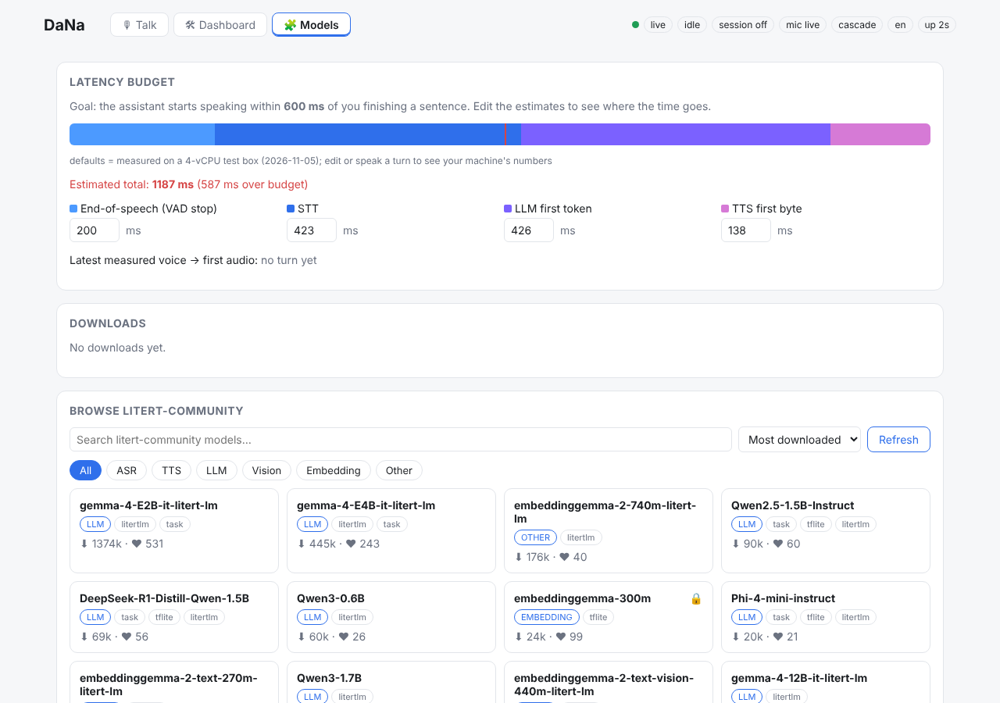
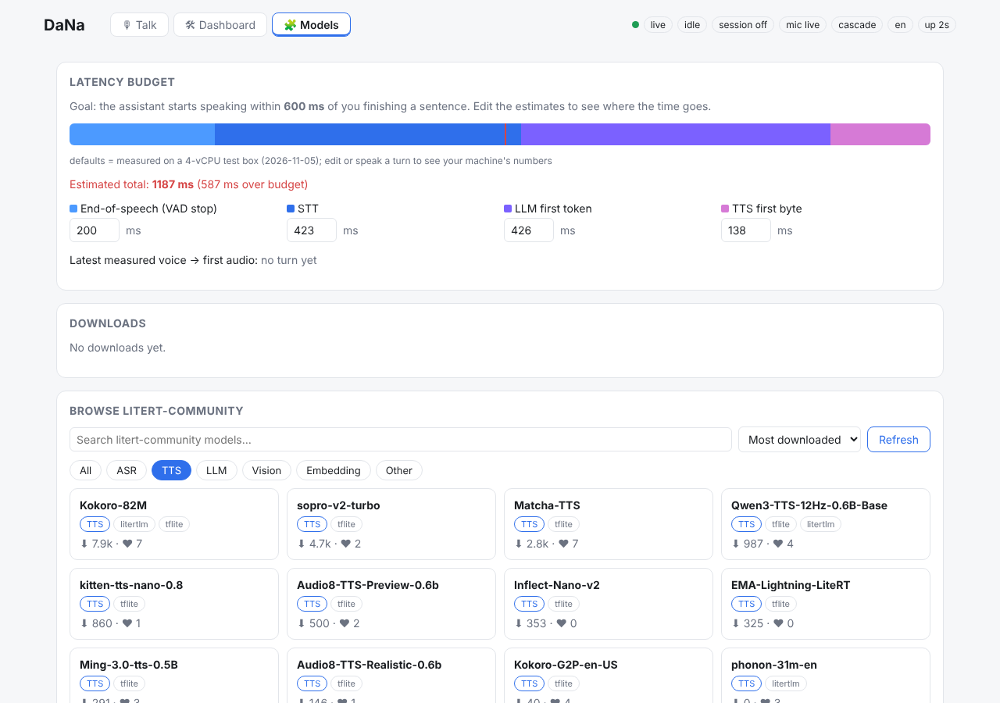
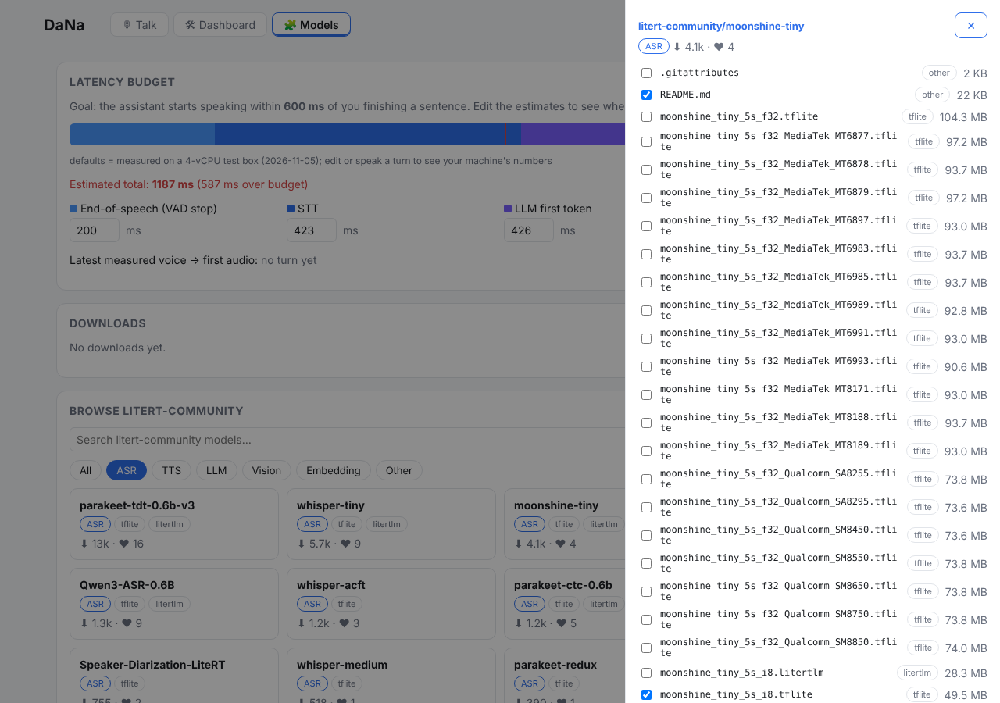
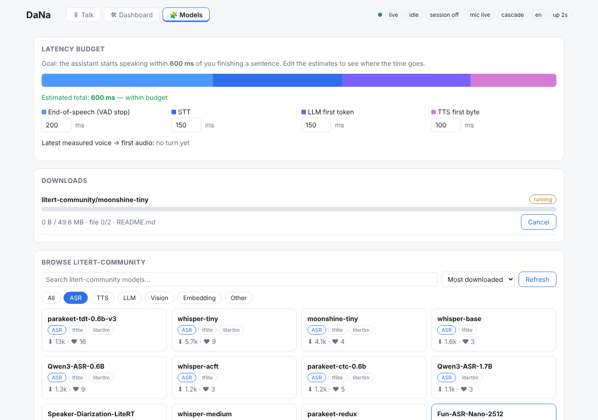
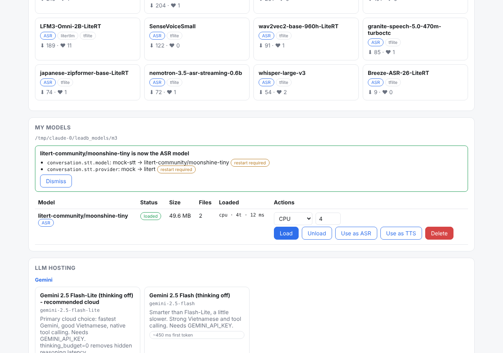
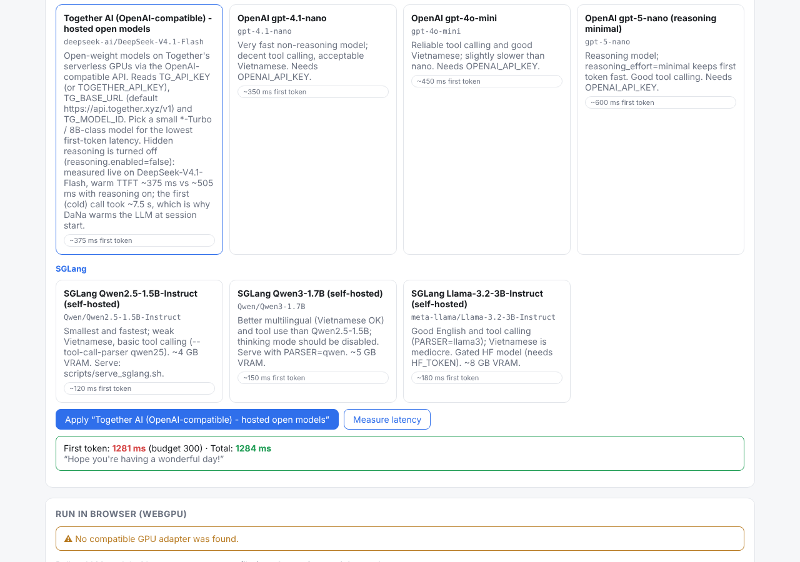

# DaNa: Models tab user guide

For: the owner (non-engineer). Goal: run DaNa's speech on your own PC, pick a
fast brain (LLM), and measure how quickly DaNa answers.

Short version: install once with an engineer, open the **🧩 Models** tab, pull
two small models, tell DaNa to use them, pick an LLM, click **Measure latency**.

---

## 1. What you need

- A Windows PC (Linux and WSL2 also work; the engineer handles those).
- Internet access to huggingface.co (to download the models).
- An API key for one cloud LLM: **Together** (recommended), **Gemini** or **OpenAI**.
  Keys go in a file, never in chat.
- Optional: a Hugging Face token (only for "gated" models that need a licence click).

## 2. Install (once, with an engineer)

Open a terminal in the `DaNa-Assistant` folder and run:

```
cd dana-agent
uv sync --dev --extra all
copy .env.example .env
```

Open `.env` in Notepad and fill in your key, for example `TG_API_KEY=...` for
Together. Save the file. The engineer can also build the dashboard once with
`cd dana-ui` then `npm run build`.

## 3. Start DaNa

```
cd dana-agent
uv run python -m dana_agent --control
```

Leave this window open. Then open a browser at **http://127.0.0.1:8760**.

The dashboard asks for the **control token**. It is stored in the file
`dana-agent/.dana/control-token`. Open it with Notepad, copy the text, and paste
it into the dashboard.

## 4. Open the 🧩 Models tab

Click **🧩 Models** in the top tab bar. The page has five parts, top to bottom:

1. **Latency budget**: the 600 ms goal split into its parts.
2. **Downloads**: progress of models being downloaded.
3. **Browse litert-community**: the catalogue of models (about 440 of them).
4. **My models**: the models already on your PC.
5. **LLM hosting**: the choice of brain.



## 5. Pull and load Moonshine (speech to text, ASR)

Moonshine is the model that turns your voice into text. It is English only.

1. In **Browse litert-community**, click the **ASR** chip.
2. Click the card **moonshine-tiny**. A side panel opens.
3. The recommended files are already ticked. Leave them as they are.
4. Click **Pull & Load**.
5. Watch the progress bar under **Downloads** until it says loaded (about 50 MB).





## 6. Pull and load KittenTTS (text to speech, TTS)

KittenTTS is the voice DaNa speaks with (English, very small, about 63 MB).

1. Click the **TTS** chip.
2. Click **kitten-tts-nano-0.8**.
3. Click **Pull & Load** and wait for "loaded" under **Downloads**.

## 7. Tell DaNa to use them: "Use as ASR" and "Use as TTS"

1. Scroll to **My models**.
2. On the **moonshine-tiny** row, click **Use as ASR**.
3. On the **kitten-tts-nano-0.8** row, click **Use as TTS**.
4. A green box lists the changes. Items marked **restart required** take
   effect after you restart DaNa (stop the window from step 3 and run it again).



## 8. Choose the brain (LLM)

Under **LLM hosting** you see preset cards grouped by provider: **Together**,
**Gemini**, **OpenAI** and **SGLang** (SGLang runs on your own GPU and is for
the engineer).

For the usual setup:

1. Click the **Together** card.
2. Click **Apply**. DaNa saves the choice.
3. Click **Measure latency**. You get a time to first word (TTFT) and a total
   time. Green means within budget, amber means slow, red means too slow.

If the test fails with "missing key", the key is not in `.env` yet (step 2).



## 9. Talk to DaNa and read the budget

1. Open the **Talk** tab and speak one short sentence.
2. Look at the latency waterfall. The bar for `voice_to_first_audio` turns red
   when it is over budget.

**How to read the latency budget**

| Part | What it is | Typical value measured |
|---|---|---|
| VAD stop | DaNa waits for you to finish speaking | 200 ms |
| STT | speech to text (Moonshine) | about 420 ms |
| LLM first word | the brain starts answering (Together) | about 430 ms |
| TTS first sound | the voice starts speaking (Kitten) | about 140 ms |
| **Total** | you stop talking to first sound | about 1.2 s |

Our target is **600 ms**. Today the full answer takes about **1.0 to 1.2 s** on
the 4-CPU test machine. That is still 2 to 4 times faster than before (2 to 4 s),
but not yet at the target. The biggest part left is the cloud brain's network
round trip. Your PC may be faster or slower; use **Measure latency** and the
waterfall to see your own numbers.

## 10. Opt-in speed switches

These are off by default. The engineer turns them on in `.env`. Only switch
them on after you have measured.

| Switch | What it does | Effect measured |
|---|---|---|
| **Speculative STT** (`SPECULATIVE_STT=true`) | DaNa starts transcribing while you are still in a pause | saves about 240 ms (recommended) |
| **Instant acknowledgement** (`ACK_ENABLED=true`) | DaNa says a short "Mm-hm." (EN) or "Dạ." (VI) straight away | you hear DaNa at about 220 ms; the full answer still follows about 1 s later |
| **Keep-warm** (`keepalive_s`) | pings the LLM during a session so it does not go cold | no gain measured on Together after 90 s idle, so leave it off |

## 11. Vietnamese setup

Vietnamese needs two different models from English:

- **Speech to text**: **whisper-tiny** (English and Vietnamese). Pull it the
  same way as Moonshine, then **Use as ASR**. Vietnamese takes about 1 to 1.5 s.
- **Text to speech**: there is no Vietnamese model for LiteRT yet, so DaNa uses
  **Piper**. The engineer must download a **vi_VN Piper voice** file first
  (it is not included with DaNa). Then set the TTS provider to **piper**.

The engineer sets the Vietnamese values in `.env`. Expect Vietnamese to be slower.

## 12. Computer use: ask DaNa to act on a website

You can ask DaNa to do things on the web, for example "search for X on that
site and open the first result". It reads the page, then clicks or types
on the elements it sees.

- It works on any site that the engineer has put on the **allowed list**
  (`ALLOWED_DOMAINS`). Links to other sites are refused.
- It **asks you before anything destructive**: delete, pay, send, or
  confirm. You will see a confirmation prompt. Say yes or no.
- Every action is written to an audit log.

## 13. Troubleshooting FAQ

**The Models tab says "Cannot reach Hugging Face".**
Your PC cannot reach huggingface.co. Check the internet connection or ask IT
whether huggingface.co is blocked. Try again after the network is fixed.

**The model says "gated" (403).**
Some models need you to accept a licence on huggingface.co. Sign in there, open
the model page, accept, then create a token and put it in `HF_TOKEN` in `.env`.
Public models do not need a token. Moonshine and KittenTTS are public.

**The first answer is very slow (several seconds). Later answers are fast.**
That is a cold start. The first call to the LLM opens a connection and loads
the model. DaNa warms it up when a session starts; wait a few seconds after
opening it before you speak.

**"Model missing" or nothing happens after Use as ASR / TTS.**
The model was not fully downloaded. Look under **Downloads**. If it failed, use
**Pull & Load** again. If the box says "restart required", restart DaNa.

**Measure latency says the key is missing or fails.**
Check `.env`: the key line must be filled in, with no extra spaces. Save the
file and restart DaNa. A copied key with an extra line break will also fail.

**Vietnamese voice is silent or missing.**
The Piper vi_VN voice file has not been downloaded yet. Ask the engineer.

**Windows notes.**
- Run commands in PowerShell from the `DaNa-Assistant` folder; keep that window open.
- SGLang (the local GPU brain) needs Linux or WSL2 with an NVIDIA GPU. The
  cloud presets (Together, Gemini, OpenAI) work on Windows directly.
- Windows app control (clicking desktop apps) has been tested only with
  simulated tests so far, not on a real Windows desktop. Treat it as
  experimental and watch what it does.

If something else breaks, note the time, what you clicked, and the message on
screen, then send it to the engineer.
